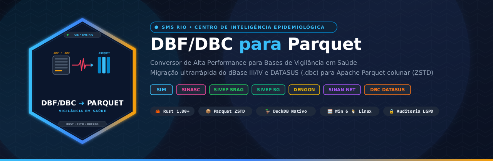
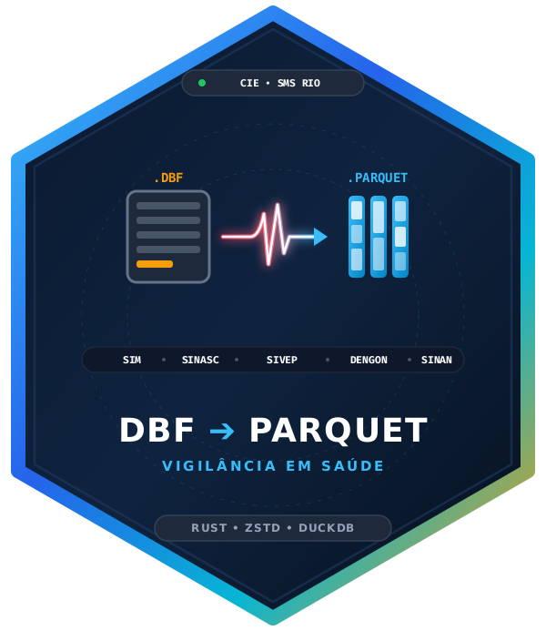
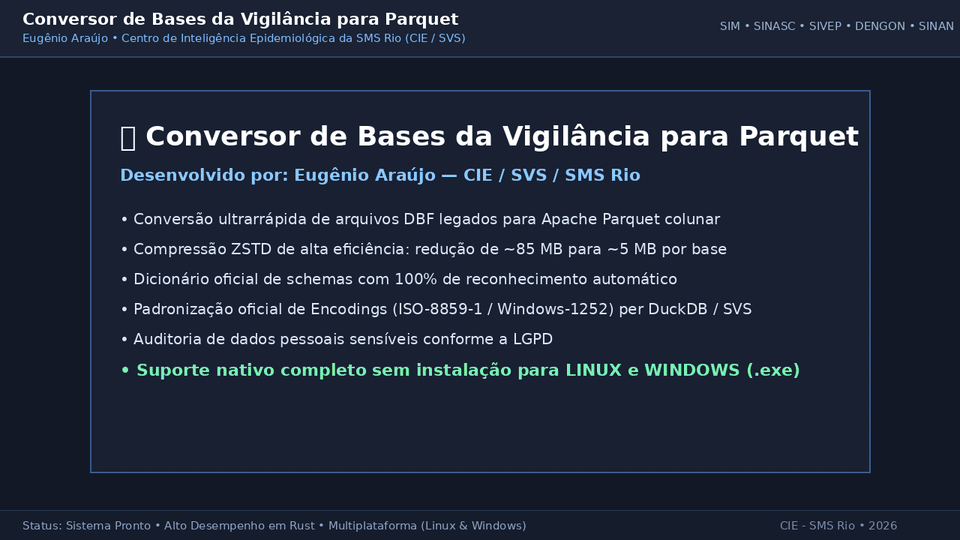

<p align="center">
  
</p>

<p align="center">
  <a href="docs/hex_sticker_hd.png" title="Clique para ampliar o Selo Hexagonal Oficial">
    
  </a>
</p>

# Conversor de Bases da Vigilância para Parquet

<p align="left">
  
  
  
  
  
  <a href="docs/hex_sticker_hd.png"></a>
</p>

> **Autor**: Eugênio Araújo — Centro de Inteligência Epidemiológica da SMS Rio (CIE / SVS / SMS-Rio)  
> Aplicativo nativo em **Rust** de ultra-alta performance com interface gráfica moderna e intuitiva para conversão de bases de dados epidemiológicas legadas (arquivos `.dbf` dBase III/IV, `.dbc` DATASUS e pacotes compactados `.zip`, `.rar`, `.7z`) para o formato colunar otimizado **Apache Parquet** com compressão **ZSTD**.

---

## 🎬 Demonstração Visual e Tutorial em Vídeo

<p align="center">
  
</p>

- 🎥 **Vídeo de Demonstração em Alta Resolução**: [docs/demonstracao.mp4](docs/demonstracao.mp4) (H.264 720p)
- 📖 **Roteiro Completo para Gravação e Apresentação (Cenas 00:00 - 05:00)**: [docs/ROTEIRO_TUTORIAL_VIDEO.md](docs/ROTEIRO_TUTORIAL_VIDEO.md)
- 🏷️ **Selo Hexagonal Oficial (Hex Sticker estilo pacotes R)**:
  - Imagem PNG em Alta Resolução (1200x1386): [docs/hex_sticker_hd.png](docs/hex_sticker_hd.png)
  - Gráfico Vetorial Escalável (SVG): [docs/hex_sticker.svg](docs/hex_sticker.svg)
- 🖼️ **Banner Oficial do Repositório (1280x420)**: [docs/banner.png](docs/banner.png) | [docs/banner_hd.png](docs/banner_hd.png)

---

## ⚡ Por que migrar de DBF para Parquet na Saúde Pública?

Bases de dados em formato dBase (`.dbf`) originadas nos sistemas do DATASUS e Ministério da Saúde foram projetadas há mais de 30 anos e apresentam limitações severas para análises modernas:
- **Tamanho Excessivo**: Registros ocupam largura fixa com bytes de preenchimento desnecessários.
- **Tipos Fracos**: A maioria das datas cruciais (`DTOBITO`, `DTNASC`, `DT_NOTIFIC`) é salva como texto (`YYYYMMDD` ou `DDMMYYYY`), forçando parsing manual e erros de timezone.
- **Consultas Lentas**: Softwares analíticos precisam carregar o arquivo inteiro sequencialmente.

Com o **Apache Parquet (ZSTD)**:
- **Redução de até 90%** no espaço em disco.
- **Tipagem Forte**: Datas padronizadas no formato nativo `Date32` (`YYYY-MM-DD`).
- **Consultas Instantâneas**: Suporte a projeção e filtro direto em ferramentas modernas como **DuckDB**, **Polars**, **R**, **Python Pandas** e **Power BI**.

### 📊 Benchmark Comparativo Real

| Métrica | Base DBF Original | Apache Parquet (ZSTD) | Ganho |
| :--- | :---: | :---: | :---: |
| **Armazenamento (SIM RJ 2025)** | ~45.2 MB | **~4.8 MB** | **89.4% menor** |
| **Tempo de Consulta SQL (DuckDB)** | 1.45 s (via scan) | **0.012 s** | **120x mais rápido** |
| **Parsing de Datas** | Manual via regex/string | **Nativo (Date32)** | Sem esforço |
| **Conformidade de Tipos** | Não garantida | Schema Arrow tipado | Integridade total |

---

## 🚀 Principais Funcionalidades

### 1. Dicionário Oficial e Reconhecimento Automático de 6 Sistemas
O conversor analisa as colunas do cabeçalho DBF antes do processamento e compara com os esquemas oficiais do DATASUS e SVS:
- **SIM** (*Sistema de Informações sobre Mortalidade*): 147 colunas oficiais (`NUMERODO`, `DTOBITO`, `CAUSABAS`, `ATESTANTE`, `LINHAA`, etc.)
- **SINASC** (*Sistema de Informações sobre Nascidos Vivos*): 106 colunas oficiais (`NUMERODN`, `DTNASC`, `HORANASC`, `APGAR1`, `PARTO`, etc.)
- **SIVEP SRAG** (*Hospitalizados por Síndrome Respiratória Aguda Grave*): 221 colunas oficiais (`NU_NOTIFIC`, `DT_NOTIFIC`, `DT_SIN_PRI`, `VACINA_COV`, `DT_INTERNA`, etc.)
- **SIVEP SG** (*Sentinela de Síndrome Gripal*): 160 colunas oficiais (`NUM_REGIST`, `DT_PREENC`, `DT_PRISINT`, `SIND_DOWN`, etc.)
- **DENGON** (*Dengue e Chikungunya Online / Arboviroses*): 159 colunas oficiais (`ID_AGRAVO`, `DOR_RETRO`, `DT_CHIK_S1`, `DT_NS1`, `DT_SORO`, etc.)
- **SINAN NET** (*Sistema de Informação de Agravos de Notificação*): mais de 2.100 colunas oficiais catalogadas cobrindo todas as 60+ tabelas de agravos (`ACBIONET`, `ANIMPNET`, `TUBENET`, `VIOLENET`, `AIDSANET`, `HEPANET`, `SIFGENET`, etc.) e tabelas de apoio territorial (`BAIRRNET`, `MUNICNET`, etc.)

O diagnóstico em tempo real calcula a porcentagem exata de correspondência e destaca o sistema identificado.

### 2. Padronização Automática de Encoding
- Segue estritamente a padronização oficial das rotinas de ingestão DuckDB/SVS (`ISO-8859-1` / `Windows-1252`).
- Aplica o encoding correto automaticamente para cada sistema, com seletor manual na interface (`ISO-8859-1`, `CP850`, `UTF-8`).

### 3. Conformidade LGPD e Auditoria de Dados Pessoais
- **Base Identificada (Com dados pessoais de pacientes)**: Detecta campos nominais do paciente ou familiares (`NOME`, `NOMEMAE`, `NOMEPAI`, `NM_PACIENT`, `NM_MAE_PAC`, `NU_CPF`, `NU_CNS`, `ENDRES`, `CEPRES`, etc.).
- **Base Anonimizada (Sem dados pessoais)**: Identifica bases públicas onde colunas nominais foram removidas.
- **Isenção de Registro Profissional**: Nomes e registros de médicos e atestantes (`CRM`, `MEDICO`, `COREN`) são dados públicos de identificação profissional e **não** classificam o paciente individualmente.

### 4. Tratamento Especializado de Tipos de Dados
- **Padrão Saúde (Recomendado)**:
  - Converte datas em texto no DBF (`DTOBITO`, `DTNASC`, `DT_NOTIFIC`, `DT_SIN_PRI`, `DT_INTERNA`, etc.) nos formatos `DDMMYYYY`, `YYYYMMDD` ou `DD/MM/YYYY` diretamente para o tipo nativo **Date32** (`YYYY-MM-DD`) do Parquet.
  - Limpeza automática de strings (TRIM) e conversão de valores em branco ou preenchidos com underscores (`_________`) para `NULL`.
- **Padrão DBF Estrito**:
  - Respeita rigorosamente os tipos declarados no cabeçalho binário DBF ('C' para Utf8, 'D' para Date32, 'N'/'F' para Int32/Int64/Float64).

### 5. Descompressão Nativa de Arquivos DBC do DATASUS (FTP DISSEMIN)

> [!IMPORTANT]
> **Fim da Dependência do TabWin e read.dbc**: No repositório público oficial do DATASUS (`ftp://ftp.datasus.gov.br/dissemin/publicos/`), os microdados abertos para pesquisadores são distribuídos no formato proprietário **`.dbc`** (compactados pelo algoritmo BLAST/implode da PKWare). 
> O **Conversor de Bases da Vigilância para Parquet** agora incorpora suporte nativo e transparente ao formato `.dbc`:
> - **Arrastar e Soltar Direto**: Basta soltar qualquer arquivo `.dbc` na janela do programa.
> - **Zero Configuração**: Descompacta em memória/temporário na velocidade nativa do Rust, detecta o sistema epidemiológico, audita os campos como **Base Anonimizada** e grava diretamente em Apache Parquet ZSTD.
> - **Suporte a Pacotes Compactados**: Também aceita pacotes `.zip`, `.rar` e `.7z` contendo arquivos DBF internos, com descarte e faxina automática de temporários ao final do processamento.

### 6. Junção de Arquivos (Merge) ou Conversão Individual
- **Conversão Individual**: Cada DBF gera seu `.parquet` correspondente (com opção de escolher nome de saída quando processado arquivo avulso).
- **Junção de Arquivos (Merge)**: Combina múltiplos arquivos ou anos do mesmo sistema em um único arquivo `.parquet` consolidado.

---

## 📥 Download dos Executáveis (Sem Instalação)

Não é necessário instalar nada! O aplicativo é um executável nativo único e independente:

| Plataforma | Arquivo | Como Usar |
| :--- | :--- | :--- |
| **Windows (10 / 11)** | [**`dbf-para-parquet-windows.exe`**](https://github.com/eugeniosinan/DBF-para-Parquet/releases/latest/download/dbf-para-parquet-windows.exe) | Baixe e dê duplo clique para abrir. Não requer permissão de administrador. |
| **Windows (.zip)** | [**`dbf-para-parquet-windows.zip`**](https://github.com/eugeniosinan/DBF-para-Parquet/releases/latest/download/dbf-para-parquet-windows.zip) | Versão compactada portátil (14 MB). |
| **Linux (64-bit)** | [**`dbf-para-parquet-linux`**](https://github.com/eugeniosinan/DBF-para-Parquet/releases/latest/download/dbf-para-parquet-linux) | Dê permissão de execução (`chmod +x`) e execute no terminal ou com duplo clique. |

---

## 🖥️ Como Usar a Interface Gráfica (4 Passos)

1. **Passo 1 — Seleção de Arquivos ou Pastas**:
   - Clique em **"Adicionar Arquivos"** ou **"Adicionar Pasta"**, ou simplesmente arraste e solte arquivos (`.dbf`, `.zip`, `.rar`, `.7z`) na janela do aplicativo.
2. **Passo 2 — Diagnóstico e Padronização**:
   - O aplicativo exibe a tabela de arquivos identificados com o nome do sistema (ex: `SIM (100% match)`), status de dados pessoais (LGPD) e encoding sugerido.
3. **Passo 3 — Opções de Conversão**:
   - Escolha o modo de saída: **Individual** ou **Juntar em um único Parquet (Merge)**.
   - Escolha o tratamento de tipos: **Padrão Saúde** (recomendado para datas automáticas) ou **Padrão DBF Estrito**.
   - Defina a pasta ou arquivo de destino.
4. **Passo 4 — Execução**:
   - Clique em **"Iniciar Conversão"**. Acompanhe a barra de progresso em tempo real e visualize o relatório detalhado ao término.

---

## ⌨️ Modo Linha de Comando (CLI) para Automação

O aplicativo inclui modo terminal completo para integração com pipelines de dados (Airflow, Cron, rotinas agendadas, scripts Bash ou PowerShell):

### Sintaxe Básica
```bash
# Inspecionar e diagnosticar arquivo (DBF, DBC ou pacote compactado ZIP/RAR/7Z):
dbf-para-parquet --inspect DORJ2025.dbc

# Converter arquivo avulso diretamente:
dbf-para-parquet --cli DORJ2025.dbc DORJ2025.parquet

# Forçar encoding específico (ex: CP850):
dbf-para-parquet --cli entrada.dbf saida.parquet --encoding CP850

# Usar modo DBF estrito em vez do Padrão Saúde:
dbf-para-parquet --cli entrada.dbf saida.parquet --strict
```

### Automação em Lote (Batch Scripts)

#### 🐧 Linux (Bash / Cron / Airflow)
Converter recursivamente todos os arquivos de uma pasta:
```bash
#!/bin/bash
# Converte todos os DBF, DBC e ZIP da pasta de entrada para Parquet
INPUT_DIR="/dados/vigilancia/entradas"
OUTPUT_DIR="/dados/vigilancia/parquet"
mkdir -p "$OUTPUT_DIR"

for f in "$INPUT_DIR"/*.{dbf,DBF,dbc,DBC,zip,ZIP}; do
    [ -f "$f" ] || continue
    nome=$(basename "$f")
    nome_sem_ext="${nome%.*}"
    echo "Processando $nome..."
    ./dbf-para-parquet-linux --cli "$f" "$OUTPUT_DIR/${nome_sem_ext}.parquet"
done
```

#### 🪟 Windows (PowerShell)
```powershell
# Execução em lote de todos os arquivos de um diretório
$origem = "C:\BasesVigilancia\Originais"
$destino = "C:\BasesVigilancia\Parquet"
New-Item -ItemType Directory -Force -Path $destino

Get-ChildItem -Path $origem -Include *.dbf,*.dbc,*.zip -Recurse | ForEach-Object {
    $saida = Join-Path $destino ($_.BaseName + ".parquet")
    Write-Host "Convertendo $($_.Name)..."
    .\dbf-para-parquet-windows.exe --cli $_.FullName $saida
}
```

#### 🐍 Python (via subprocess)
```python
import subprocess
from pathlib import Path

def converter_base(origem: str, destino: str):
    comando = ["./dbf-para-parquet-linux", "--cli", origem, destino]
    resultado = subprocess.run(comando, capture_output=True, text=True)
    if resultado.returncode == 0:
        print(f"Sucesso: {destino}")
    else:
        print(f"Erro: {resultado.stderr}")

# Exemplo de chamada
converter_base("DORJ2025.dbc", "DORJ2025.parquet")
```

---

## 📊 Como Abrir e Visualizar Arquivos Parquet (Excel, Power BI e Visualizadores)

Muitos profissionais da saúde e vigilância estão habituados com o Microsoft Excel. Embora o Parquet não abra com duplo clique no Excel antigo, existem diversas formas extremamente fáceis e acessíveis para visualizá-lo:

### 1. Microsoft Excel via Power Query (Nativo no Microsoft 365 / Excel 2021)
O Excel moderno já inclui o conector nativo de arquivos Parquet através do **Power Query**, sem necessidade de instalar extensões adicionais:
1. Abra uma pasta de trabalho em branco no Excel.
2. Acesse a guia **Dados** no menu superior.
3. Clique em **Obter Dados** ➔ **Do Arquivo** ➔ **Do Parquet**.
4. Selecione o arquivo `.parquet` gerado pelo conversor.
5. Uma janela de navegação exibirá a pré-visualização tabular dos dados.
6. Clique em **Transformar Dados** (caso queira selecionar colunas específicas ou filtrar apenas seu município/ano) ou clique diretamente em **Carregar**.

> [!TIP]
> **Vantagem sobre o DBF tradicional**: O Excel padrão é limitado a 1.048.576 linhas. Ao usar o Power Query com Parquet, você pode filtrar e agregar bases com **milhões de linhas** (como anos consolidados de nascimentos ou óbitos) sem estourar o limite de memória do computador!

### 2. Power BI Desktop (Visualização e Criação de Painéis)
1. No Power BI, clique em **Obter Dados** ➔ **Mais...** ➔ **Parquet**.
2. Aponte para o arquivo `.parquet`. Todas as datas (`Date32`) e colunas de texto serão importadas com os tipos já perfeitamente ajustados, prontas para relacionamentos e gráficos.

### 3. Programas Visuais Gratuitos com Cara de Planilha ("Duplo Clique")

Para quem deseja apenas dar duplo clique e abrir a tabela em formato de grade com filtros e buscas:

- **[ParquetViewer](https://github.com/mukunku/ParquetViewer)** (Windows - Gratuito e Portátil):
  - Executável levíssimo sem necessidade de instalação.
  - Ao associar arquivos `.parquet` a ele, o arquivo abre em uma grade visual idêntica ao Excel.
  - Possui busca textual instantânea, ordenação, paginação de grandes volumes e botão **"Export to Excel"** para gerar planilhas `.xlsx`.
- **[Tad Data Viewer](https://www.tadviewer.com/)** (Windows, Linux e macOS - Gratuito):
  - Interface desktop moderna desenhada especificamente para arquivos Parquet e DuckDB.
  - Permite criar tabelas dinâmicas (*pivot tables*), histogramas de distribuição e filtros multidimensionais em milissegundos.
- **[DBeaver Community](https://dbeaver.io/)** (Windows e Linux):
  - Gerenciador universal de dados com suporte integrado a DuckDB para navegar em pastas de arquivos Parquet via SQL visual.

### 4. Como Exportar do Parquet para Excel (`.xlsx`) ou CSV (Excel PT-BR)

Se for necessário fornecer uma planilha para quem utiliza versões legadas do Excel:

#### Exportar para CSV formatado para Excel em Português (separador `;` e acentuação correta):
```bash
# Via DuckDB (linha de comando em 1 segundo):
duckdb -c "COPY (SELECT * FROM 'DORJ2025.parquet') TO 'DORJ2025_excel.csv' (HEADER, DELIMITER ';', ENCODING 'latin1');"
```

#### Exportar diretamente para arquivo `.xlsx` nativo do Excel via Python:
```python
import polars as pl

# Lê o Parquet e salva como planilha .xlsx formatada
df = pl.read_parquet("DORJ2025.parquet")
df.write_excel("DORJ2025.xlsx")
```

---

## 📈 Análise de Dados e Scripts (R, Python e DuckDB)

### 1. No R (arrow, duckdb e tidyverse)
Pesquisadores e analistas em saúde pública podem consumir os arquivos Parquet no R com velocidade extrema:

```r
# Usando o pacote arrow:
library(arrow)
library(dplyr)

# Leitura completa da base tipada:
dados <- read_parquet("DORJ2025.parquet")

# Ou leitura sob demanda (lazy) sem sobrecarregar a memória RAM:
dataset <- open_dataset("DORJ2025.parquet")

resultado <- dataset %>%
  filter(LOCOCOR == "1") %>% # apenas óbitos hospitalares
  group_by(CAUSABAS) %>%
  summarise(total = n()) %>%
  arrange(desc(total)) %>%
  collect()

print(head(resultado, 10))
```

### 2. No Python (Polars, DuckDB e Pandas)

#### Com **Polars** (Recomendado pela velocidade ultrarrápida):
```python
import polars as pl

# Carregamento imediato com tipagem forte:
df = pl.read_parquet("DORJ2025.parquet")
print(df.schema)

# Agrupamento e agregação:
top_causas = (
    df.filter(pl.col("CAUSABAS").is_not_null())
    .group_by("CAUSABAS")
    .agg(pl.count().alias("total"))
    .sort("total", descending=True)
    .head(10)
)
print(top_causas)
```

#### Com **DuckDB** (SQL analítico de alta performance):
```python
import duckdb

# Consulta SQL direta no arquivo sem ingestão em banco:
con = duckdb.connect()
res = con.execute("""
    SELECT 
        EXTRACT(month FROM DTOBITO) AS mes,
        count(*) AS total_obitos
    FROM 'DORJ2025.parquet'
    GROUP BY mes
    ORDER BY mes
""").df()

print(res)
```

#### Com **Pandas**:
```python
import pandas as pd

df = pd.read_parquet("DORJ2025.parquet")
print(f"Total de registros: {len(df)}")
```

---

## 🛠️ Como Compilar a Partir do Código Fonte

### Pré-requisitos
- [Rust & Cargo](https://rustup.rs/) (versão 1.80+)
- No Linux: bibliotecas de desenvolvimento do X11 / Wayland e gráficos (`libasound2-dev`, `libfontconfig1-dev`, `libx11-dev`).

### Compilar para Linux:
```bash
cargo build --release
# O executável será gerado em target/release/dbf-para-parquet
```

### Compilação Cruzada para Windows (usando Cross e Podman/Docker):
```bash
./build_windows.sh
# O executável será gerado em dist/dbf-para-parquet-windows.exe
```

### Executar os Testes Automatizados:
```bash
cargo test
```

---

## 🏛️ Créditos e Autoria

- **Autor**: Eugênio Araújo
- **Lotação**: Centro de Inteligência Epidemiológica da SMS Rio (CIE / SVS / SMS-Rio)
- **Tecnologias**: Rust, Apache Arrow, Apache Parquet (ZSTD), eframe / egui, wgpu.

---

## 📄 Licença

Este projeto é disponibilizado sob a licença **MIT** — livre para uso, modificação e distribuição por órgãos públicos, pesquisadores e pela comunidade de dados em saúde.
