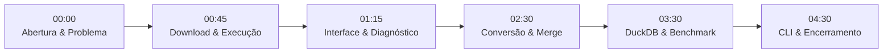

# 🎬 Roteiro e Guia de Gravação — Tutorial em Vídeo

**Projeto**: Conversor de Bases da Vigilância para Parquet  
**Autor**: Eugênio Araújo — Centro de Inteligência Epidemiológica da SMS Rio (CIE / SVS / SMS-Rio)  
**Duração Estimada**: 4 a 5 minutos  
**Resolução Recomendada**: 1920x1080 (Full HD) a 60 FPS  
**Público-alvo**: Epidemiologistas, analistas de dados, técnicos de vigilância em saúde (CIE, Cievs, SVS, SMS, SES, Ministério da Saúde, Fiocruz, universidades).

---

## 📋 Pré-requisitos e Setup Técnico para Gravação

### 1. Ferramenta de Gravação
- **OBS Studio** (Linux / Windows)
  - Resolução Base/Saída: `1920x1080`
  - Taxa de Quadros: `60 fps`
  - Filtros de Áudio no Microfone: *Supressão de Ruído (RNNoise)*, *Compressor* e *Ganho*.
  - Dica de Cursor: Ativar realce de clique do mouse no sistema operacional para facilitar o acompanhamento pelo espectador.

### 2. Ambiente de Demonstração
- Janela do **Conversor de Bases da Vigilância para Parquet** aberta e centralizada.
- Terminal aberto ao lado (ou em janela secundária) para demonstrar consulta DuckDB ou linha de comando.
- Uma pasta de exemplo preparada com arquivos representativos:
  - `DORJ2025.zip` ou `DORJ2025.dbf` (SIM - Sistema de Mortalidade)
  - `DNRJ2025.dbf` (SINASC - Sistema de Nascidos Vivos)
  - `SRAG_2024.dbf` (SIVEP SRAG)
  - `DENGON.dbf` (Dengue/Chikungunya)
  - `TUBENET.dbf` ou `ANIMPNET.dbf` (SINAN NET)

---

## ⏱️ Linha do Tempo e Script de Narração



---

### Cena 1: Abertura e o Desafio dos DBFs na Saúde Pública (00:00 - 00:45)

**Ação Visual na Tela:**
- Câmera do apresentador em destaque ou transição de slide com o título: *"Conversor de Bases da Vigilância para Parquet — Do DBF Legado ao Apache Parquet em Segundos"*.
- Em seguida, transição suave para a área de trabalho mostrando pastas cheias de arquivos `.dbf` e `.zip` antigos do DATASUS.

**Texto da Narração (Voz):**
> *"Olá a todos! Eu sou o Eugênio Araújo, do Centro de Inteligência Epidemiológica da Secretaria Municipal de Saúde do Rio de Janeiro.*  
> *Quem trabalha com vigilância epidemiológica e análise de dados em saúde pública conhece bem a nossa realidade: lidamos diariamente com bases históricas em formato DBF — dBase dos anos 80 e 90 — vindas do SIM, SINASC, SIVEP Gripe, DENGON e SINAN NET.*  
> *Esses arquivos são pesados, difíceis de consultar, frequentemente vêm compactados em ZIP ou 7z, e cada sistema tem um encoding e peculiaridades de datas diferentes.*  
> *Para resolver esse gargalo de ponta a ponta, desenvolvemos este **Conversor Nativo em Rust**, ultrarrápido, seguro e com interface gráfica moderna para Linux e Windows. Vamos ver na prática como ele funciona!"*

---

### Cena 2: Instalação e Execução Portátil (00:45 - 01:15)

**Ação Visual na Tela:**
- Mostrar a página de Releases do repositório no GitHub ou a pasta com o arquivo `dbf-para-parquet-windows.exe` no Windows e `./dbf-para-parquet-linux` no Linux.
- Dar duplo clique no executável. O aplicativo abre instantaneamente (menos de meio segundo).

**Texto da Narração (Voz):**
> *"A primeira grande vantagem é a simplicidade de uso: o programa não precisa de instalação, não precisa de Python, não precisa de Java e não exige privilégios de administrador.*  
> *Basta baixar o executável oficial. No Windows, você simplesmente dá duplo clique no arquivo `.exe`. No Linux, executa o binário nativo. Ele abre instantaneamente, com interface gráfica limpa, fluida e acelerada por hardware."*

---

### Cena 3: Passo a Passo na Interface Gráfica (01:15 - 02:45)

#### Passo 1 — Adicionar Arquivos e Suporte a Compactados (01:15 - 01:40)
**Ação Visual na Tela:**
- Clicar em **"Adicionar Arquivos"** ou arrastar múltiplos arquivos diretamente para a janela: um `.zip` com DBF interno, um `.dbf` do SIM, um do SINASC e um do SINAN NET.

**Texto da Narração (Voz):**
> *"O fluxo de trabalho foi desenhado em 4 passos intuitivos.*  
> *No **Passo 1**, nós selecionamos os arquivos ou até mesmo uma pasta inteira. O conversor aceita arquivos `.dbf` brutos ou diretamente pacotes `.zip`, `.rar` e `.7z`.*  
> *O programa examina os arquivos compactados em memória, extrai os DBFs necessários temporariamente e, ao final da conversão, limpa os temporários automaticamente para não ocupar espaço em disco."*

#### Passo 2 — Diagnóstico Inteligente de Sistemas e LGPD (01:40 - 02:15)
**Ação Visual na Tela:**
- O cursor aponta para a tabela do **Passo 2**.
- Mostrar os badges coloridos aparecendo:
  - `SIM (100% match)`
  - `SINASC (100% match)`
  - `SINAN NET (98% match)`
  - Mostrar a coluna de **Dados Pessoais** (`Com dados pessoais` vs `Anonimizada`).

**Texto da Narração (Voz):**
> *"Agora reparem no **Passo 2: Diagnóstico e Padronização**.*  
> *Antes de qualquer conversão, o programa inspeciona o cabeçalho de cada base e cruza com nosso dicionário oficial de mais de 2.100 colunas catalogadas do DATASUS.*  
> *Ele reconhece automaticamente se a base é do SIM, SINASC, SIVEP SRAG, SIVEP SG, DENGON ou de qualquer agravo do SINAN NET, informando a precisão do schema e definindo o encoding correto, que no padrão da saúde é o ISO-8859-1.*  
> *Além disso, há uma auditoria de privacidade LGPD: o software avisa se a base possui campos nominais de pacientes ou se é uma base pública anonimizada — ressaltando que CRM e registro de profissionais de saúde não são dados pessoais do paciente."*

#### Passo 3 e 4 — Tipos de Dados e Conversão (02:15 - 02:45)
**Ação Visual na Tela:**
- Clicar no botão `ℹ` ao lado de **"Padrão Saúde"** para exibir a dica explicativa.
- Escolher modo de conversão: demonstrar a opção **"Individual"** e a opção **"Juntar em um único Parquet (Merge)"**.
- Clicar no botão verde **"Iniciar Conversão"**.
- A barra de progresso avança rapidamente.
- O relatório de conclusão verde surge na tela com total de linhas e tamanho economizado.

**Texto da Narração (Voz):**
> *"No **Passo 3**, você escolhe se deseja converter cada arquivo individualmente ou consolidar múltiplos arquivos ou anos em uma única tabela Parquet.*  
> *E aqui está um diferencial essencial para quem faz análise de dados: o **Padrão Saúde**! Clicando no ícone de informação, vemos que datas gravadas como texto no DBF — como data do óbito, data de nascimento e data da notificação — são convertidas diretamente para o formato nativo Date32 (`AAAA-MM-DD`). Valores em branco e caracteres de preenchimento são devidamente convertidos para valores nulos.*  
> *Clicamos em **Iniciar Conversão**: o motor em Rust processa dezenas de milhares de registros por segundo, utilizando compressão colunar ZSTD!"*

---

### Cena 4: Demonstração do Resultado com DuckDB (02:45 - 03:45)

**Ação Visual na Tela:**
- Abrir um terminal com `duckdb` (ou Python / DBeaver) apontando para o arquivo `.parquet` recém-gerado.
- Mostrar a diferença de tamanho de arquivo no gerenciador de arquivos: de 50 MB (DBF) para 4 MB (Parquet).
- Executar queries analíticas SQL instantâneas no DuckDB:
  ```sql
  SELECT count(*), min(DTOBITO), max(DTOBITO) FROM 'DORJ2025.parquet';
  SELECT CAUSABAS, count(*) FROM 'DORJ2025.parquet' GROUP BY CAUSABAS ORDER BY count(*) DESC LIMIT 5;
  ```
- O resultado retorna em 5 milissegundos.

**Texto da Narração (Voz):**
> *"Vejam só o resultado: uma base que ocupava dezenas de megabytes no DBF foi reduzida em até 85% a 90% graças à compressão ZSTD do Parquet.*  
> *E o melhor de tudo: ao abrir com ferramentas modernas como DuckDB, Python Pandas, Polars ou R, as datas já estão tipadas corretamente. Uma agregação sobre centenas de milhares de linhas é respondida em meros milissegundos, pronta para dashboards no Power BI, Evidence ou Shiny!"*

---

### Cena 5: Modo Linha de Comando (CLI) para Pipelines (03:45 - 04:20)

**Ação Visual na Tela:**
- No terminal, digitar:
  ```bash
  dbf-para-parquet --inspect DORJ2025.zip
  dbf-para-parquet --cli DORJ2025.zip DORJ2025.parquet
  ```
- Mostrar o diagnóstico em texto no terminal e a conversão concluída.

**Texto da Narração (Voz):**
> *"E para quem constrói rotinas automatizadas de ETL em servidores ou agendamentos diários via cron ou Airflow, o aplicativo também conta com modo linha de comando completo.*  
> *Basta passar o parâmetro `--inspect` para inspecionar os metadados ou `--cli` indicando o arquivo de entrada e saída. Ele roda silenciosamente e com alta performance em qualquer pipeline."*

---

### Cena 6: Encerramento, Repositório e Contatos (04:20 - 05:00)

**Ação Visual na Tela:**
- Mostrar a página inicial do repositório no GitHub: `https://github.com/eugeniosinan/DBF-para-Parquet`.
- Mostrar a seção de Releases com os links de download direto.
- Cartão final com os créditos do desenvolvedor.

**Texto da Narração (Voz):**
> *"O projeto é 100% open source e está disponível publicamente no GitHub no endereço `github.com/eugeniosinan/DBF-para-Parquet`.*  
> *Lá você encontra a documentação detalhada, o guia de compilação e os links diretos para download das versões Linux e Windows.*  
> *Espero que essa ferramenta acelere bastante as pesquisas e o trabalho de vigilância em saúde no seu município ou estado. Sintam-se à vontade para abrir issues, sugerir melhorias e compartilhar com seus colegas de equipe.*  
> *Um grande abraço e até a próxima!"*

---

## 📽️ Demonstração Visual Rápida (Preview)

O repositório inclui animações e vídeo de demonstração prontos na pasta `docs/`:
- **Vídeo MP4**: [`docs/demonstracao.mp4`](demonstracao.mp4) (Demonstração completa em 720p H.264)
- **Animação GIF**: [`docs/demonstracao.gif`](demonstracao.gif) (Pré-visualização para o README)

---

## 💡 Dicas para a Apresentação
1. **Ritmo de Fala**: Mantenha um tom claro, seguro e pausado, articulando bem os termos técnicos da saúde (`DATASUS`, `SIM`, `SINASC`, `SIVEP`, `Parquet`, `DuckDB`).
2. **Foco no Benefício Prático**: Destaque a economia de tempo dos técnicos de vigilância que antes sofriam com travamentos e limitações do DBF.
3. **Privacidade**: Não utilize bases com dados reais de pacientes em vídeos públicos — use as bases de teste ou amostras anonimizadas.
